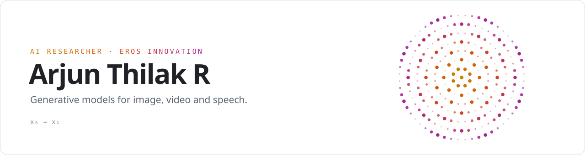
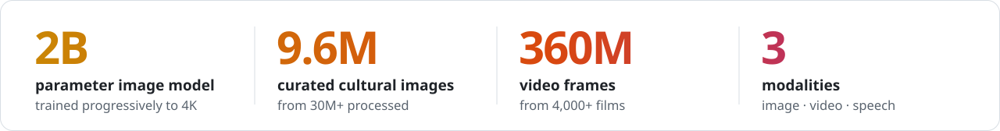

<picture>
  <source media="(prefers-color-scheme: dark)" srcset="assets/hero-dark.svg">
  
</picture>

I'm an AI researcher at **Eros Innovation** in Chennai, where I train generative models for images, video and speech. Most of my time goes into flow-matching models, neural audio, and the data pipelines that feed them.

[LinkedIn](https://linkedin.com/in/arjun-thilak) · [Kaggle](https://www.kaggle.com/rarjunthilak) · [Email](mailto:arjunthilak2005@gmail.com)

### Now

<picture>
  <source media="(prefers-color-scheme: dark)" srcset="assets/stats-dark.svg">
  
</picture>

- **Speech.** Building an expressive English text-to-speech system from scratch: the audio codec, the language model on top of it, and the tuning that makes it sound natural.
- **Image.** Core engineer on India's first culturally specialised text-to-image model, trained progressively up to 4K on Indian dance, cuisine, architecture and textiles.
- **Video.** Built the pipeline that turns thousands of full-length films into training data for a text-to-video foundation model.
- **Data and infrastructure.** I run the GPU cluster and the distributed pipeline that captions, filters and cleans tens of millions of images.

### Research

- **GAUGE: Measuring Monitoring–Control Coupling as a Metacognitive Failure Mode in LLMs.** ICST 2026 (Springer). Grand Prize, Google DeepMind × Kaggle *Measuring Progress Toward AGI*. [code](https://github.com/arjunthilak05/gauge-metacognition)
- **One-Cuff Subject Calibration for Facial rPPG Blood Pressure on MCD-rPPG.** IEEE EMBS BHI 2026.
- **Two-Stage Personalization of Audio Language Models for Aphasic Speech.** Under review. Fine-tunes Whisper-Large-v3 and Gemma 4 on AphasiaBank, cutting per-speaker WER from 0.625 to 0.521. [code](https://github.com/arjunthilak05/aphasiabridge)
- **Missing Callers Under a Response Budget: Finishing Versus Finding in a Local Gemma 4 Agent.** With Ramkumar M V. [paper](https://github.com/arjunthilak05/missing-callers-gemma4/blob/main/paper/Missing_Callers_paper.pdf) · [code](https://github.com/arjunthilak05/missing-callers-gemma4)
- **A Hybrid Approach to License Plate Recognition: YOLO-v9 and Quantum-Enhanced CNN Model.** IEEE GCITC 2024. [paper](https://ieeexplore.ieee.org/document/10862831)

### Open source

- **[antigravity-claude-mcp](https://github.com/arjunthilak05/antigravity-claude-mcp)**: lets Claude Code ask Gemini for a second opinion on a plan or diff. Available on [npm](https://www.npmjs.com/package/antigravity-claude-mcp).
- **[UWE-SkinLesion](https://github.com/arjunthilak05/UWE-SkinLesion)**: an 11-model ViT + CNN ensemble weighted by uncertainty. 85.6% balanced accuracy on HAM10000.
- **[TinyLLM-Quantization](https://github.com/arjunthilak05/TinyLLM-Quantization)**: PTQ vs. QAT at INT8/INT4 for small LLMs on Apple Silicon.

More

 

- [RapidEye-DisasterAI](https://github.com/arjunthilak05/RapidEye-DisasterAI): satellite damage segmentation with response-urgency ranking
- [Multimodal-RAG](https://github.com/arjunthilak05/Multimodal-RAG): CLIP + FAISS + BM25 hybrid retrieval over text, images and tables
- [Entropy-QGAN](https://github.com/arjunthilak05/Entropy-QGAN): entanglement-entropy regularisation for quantum GANs
- [CarParts-YOLOv11](https://github.com/arjunthilak05/CarParts-YOLOv11): 19-class car-part detection

### Background

BS in Computing & Data Science from **Sai University** (CGPA 9.0) and a Diploma in Data Science from **IIT Madras**, both 2022–26. In 2026 I was selected for the CS research cohort at Chennai Mathematical Institute. Before Eros I worked at HAL and IIT Madras Pravartak.

PyTorch · CUDA · distributed training and inference
